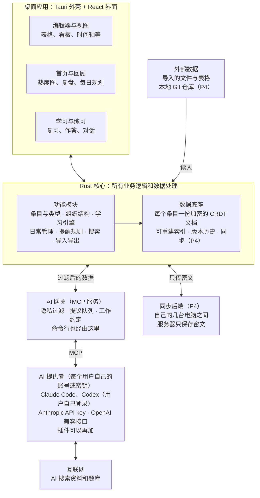

# Jady 总体架构

> 文档组：[01 PRD](01-prd.md) · 02 总体架构 · [03 模块说明](03-modules.md) · [04 阶段说明](04-phases.md) · [05 设计规范](05-design.md)
>
> 本文档讲整体结构和跨模块的决定。每个模块的细节见《模块说明》。标注“建议”的是待确认方案；涉及具体开源库的地方，开发前要再评估它们当时的状态。

## 1. 设计原则

后面所有具体决定都应该能回溯到其中一条（括号里是 PRD 对应项）。

- **本地优先**：所有数据都在自己的电脑上，所有操作先在本地完成，没网时体验不变。同步只是把变化传给自己的其他电脑。（F2）
- **AI 深度融合，但不是唯一通道**：AI 参与每个环节，但核心数据和基本功能不依赖它。AI 不可用或额度用完时，软件照常运转。
- **AI 的三种动作分开处理**：在对话里说话，直接显示；按指令生成新内容，直接写入；改动已有内容，先变成提议，由我确认或按授权通过。三种动作在架构上走不同的通道。（D 组）
- **隐私靠代码保证**：AI 能看什么，由软件在数据出口处强制过滤，而不是靠提示词要求 AI 自觉。（D1、F1）
- **管理思想写进数据结构**：GTD 和 OKR 是数据模型里的一等结构，但都不强制使用。
- **维护交给 AI**：整理、补全、合并、归档这些维护工作，尽量由 AI 定期提议，我只做确认。
- **核心小，零件多**：核心只管条目、类型、关系、时间和存储。内容类型、视图、学习零件、生活模板都以模块形式挂上去，自定义类型和内置类型走同一套机制。
- **索引可以重建**：搜索索引、统计数据都从原始数据算出，坏了删掉重建即可。
- **不自己发明密码学**：加密一律使用成熟、经过审计的库和标准算法。
- **数据永远能带走**：专有格式的规范有文档，任何时候都能完整导出成通用格式。

## 2. 总体结构

整个系统是一个桌面应用，分成界面、核心和边界三部分。核心之外的一切，只能通过边界接触数据。

| 部分 | 职责 |
| --- | --- |
| 界面层 | 用 Web 技术写界面，由 Tauri 打包成桌面应用。只负责显示和交互，不放业务逻辑 |
| Rust 核心 | 所有业务逻辑和数据处理。功能模块建在数据底座之上：底座负责存储、加密、索引、版本历史；模块负责条目与类型、组织结构、学习、日常管理、提醒、搜索、导入导出 |
| AI 网关 | AI 接触数据的唯一入口，以 MCP 服务的形式向 Claude 提供工具。按隐私层级过滤数据，把 AI 对已有内容的改动放进提议队列，在会话开始时附上 AI 工作约定。本地命令行工具（P2）也经由这一层 |
| AI 提供者 | 每个用户用自己的 AI 账号或密钥。Claude Code 是主要引擎，由软件在后台启动，用户在未修改的 Claude Code 里登录自己的账号；也支持 Codex（同样由用户自己登录）、Anthropic API key 直连，以及 OpenAI 兼容接口（DeepSeek、Ollama、LM Studio 等）；别的以插件方式加入。Claude App 是可选入口。AI 上网搜资料、找题目，结果同样经网关写入库 |
| 外部数据 | 导入的文件和表格，以及 P4 的本地 Git 仓库。只读入，不外传 |
| 同步后端（P4） | 只在自己的几台电脑之间同步，服务器只保存密文 |

**平台**：目前只做 macOS（2026-11-02 确认），Windows、Linux 以后再做，同一套代码。手机端和网页端暂缓，但核心和数据格式从一开始就按“将来可以跑在别的平台上”设计。

## 3. 技术选型

| 层 | 选择 | 备选 | 状态与理由 |
| --- | --- | --- | --- |
| 核心语言 | Rust | — | 已定。性能和内存安全；以后上手机和网页时，同一份代码也能编译过去 |
| 桌面外壳 | Tauri 2 | Electron | 建议。和 Rust 核心直接集成，安装包小；全局快捷键、通知、托盘都有官方插件 |
| 界面框架 | TypeScript + React，Vite 构建单页应用 | Svelte、SolidJS | 已定。生态最大：停靠式工作区布局、首页网格、白板、表格都有成熟组件；和现有网站（Next.js）同属 React 生态；桌面应用不用 Next.js |
| 无头组件库 | React Aria Components | Radix UI | 已定（2026-10-21，P0.5-05，见 `docs/spikes/07-ui-components.md`）。有组合框、自动补全、树、表格、日期、颜色选择、拖放、虚拟列表；输入法组字时不误选；在 WKWebView 里 Tab 键能走到每个按钮。右键菜单自己用 Popover + Menu 接。Apache-2.0，开源发布时带上它的 NOTICE |
| 图标 | Lucide，界面只通过自己的图标登记表取图标 | Phosphor | 已定（同上）。登记表让“图标方案”可以换成别的图标库或主题包自带的图标 |
| 停靠布局 | dockview，外面包一层自己的布局封装 | FlexLayout | 已定（同上）。“最多 3 × 3”、页签的三种状态、保存格式都放在封装里，换库只改封装。FlexLayout 在 React StrictMode 下拖动失效，不选 |
| 液态玻璃 | 壁纸和首页场景画进一个 WebGL 背景层，玻璃面板下的折射和模糊由它画；盖在正文上的浮层用 CSS 模糊，CSS 先写一条只有模糊的兜底 | CSS 的 SVG 滤镜折射（只有 Chromium 支持） | 已定（同上）。两个平台效果一致。WKWebView 里的开销在 P0.5-06 测；Safari 的观感和帧率按清单补测 |
| 首页三维场景 | three.js | — | 建议。星图在 M1 上每帧约 10 毫秒（含溢光），8 块玻璃几乎不增加开销（Chromium）。吃力时依次关溢光、降像素密度、在“减少透明度”里关玻璃 |
| 富文本编辑器 | ProseMirror（或基于它的 Tiptap） | Lexical | 建议。支持自定义节点：记忆卡、批注、对照文本、图表；有现成的 CRDT 绑定 |
| 代码和公式输入 | CodeMirror 6 | Monaco | 建议。做题作答界面，可接语言服务器 |
| 画图 | Mermaid 渲染，加上 SVG 直接显示 | — | 建议 |
| 统计图表 | 轻量图表库（如 ECharts） | Observable Plot | 建议。掌握度、财务统计、平衡轮 |
| 热度图 | Canvas 2D 自己绘制 | — | 已定（2026-11-02，P0.5-08 比较了三种，选年历墙，见 `docs/05-design.md` 第 8.1 节） |
| CRDT 文档库 | Loro 1.16.x | Automerge、yrs | 已定（P0 验证，见 `docs/spikes/01-crdt.md`）。Rust 原生，富文本、版本历史和可移动的树结构支持好。Rust 核心与界面用同一版本，只用 1.0 起就有的容器 |
| 本地索引 | SQLite，FTS5 加自定义分词，整体用 SQLCipher 加密 | Tantivy | 建议。成熟、单文件、可重建。SQLCipher 用内置 OpenSSL，备选 libtomcrypt；分词器的 FFI 只放在 `dem-index` 的一个文件里（见 `docs/spikes/02-search.md`） |
| 繁简转换 | 索引用由 OpenCC 词典生成的逐字折叠表（带版本号）；展示性转换用 `ferrous-opencc` | — | 建议（见 `docs/spikes/02-search.md`） |
| 加密 | libsodium 系算法（XChaCha20-Poly1305、Argon2id），实现用 RustCrypto（`chacha20poly1305` 0.10、`argon2` 0.5、HKDF/HMAC-SHA256） | age | 建议。成熟、经过审计；细节见 `docs/format-spec.md` 第 4 节 |
| 复习排期 | FSRS 的 Rust 实现 | SM-2 | 建议 |
| AI 接入 | MCP 官方 SDK，加 Claude Code 的无交互模式和 Codex 的 `codex exec`；Anthropic API key 和 OpenAI 兼容接口直连 | 别的 agent 工具（以插件加入） | 已定（2026-10-19 调整）。每个用户用自己的账号或密钥，软件不经手 Claude 登录凭据。网关用“转接程序 + 本机套接字（Windows 命名管道）+ 一次性令牌”，不开 TCP 端口（见 `docs/spikes/05-claude-code-mcp.md`） |
| 知识检索 | 全文搜索加 AI 工具检索；本地向量检索作为后续增强 | 专门的向量数据库 | 先做前者；向量检索 P3 用真实数据测试后再定 |
| 语音转文字 | 本地运行的语音识别模型 | 系统自带听写 | 建议，需评估。不上传录音 |
| 文件解析 | PDF 文字提取库、幻灯片解析 | — | 建议 |
| 代码题检查 | 语言服务器（rust-analyzer、clangd、Pyright）、本机工具链编译、系统沙盒运行（macOS 用 Seatbelt） | Wasmtime（没有系统沙盒的平台跑 Rust）、容器 | 已定分步：前两者 P3，沙盒 P4。2026-11-03 改用系统沙盒，见 `docs/spikes/native-sandbox.md` |
| 本地 Git | gitoxide 或 libgit2 | 调用 git 命令 | 建议。P4 |
| 专用浏览器 | 系统 Chrome（或 Edge、Brave）加独立配置，DevTools 协议走管道 | 随软件带 Chromium | 已定（2026-11-03），见 `docs/spikes/dedicated-browser.md` |
| 字体 | 界面用系统字体；长文默认霞鹜文楷（Regular 随软件分发，Medium 用到时下载）；Archivo、JetBrains Mono 随软件分发；罕见文字用 Noto 系列，用到时下载 | — | 已定（2026-10-21，P0.5-04，见 `docs/05-design.md` 附录 B.3）。四个字体位置都能自定义：系统字体、推荐的开源字体、导入自己的字体文件 |

## 4. 跨模块的核心设计（摘要）

细节见《模块说明》对应章节。

- **一切皆条目**：笔记、待办、记忆卡、目标、人物、收支记录在核心里都是“条目”，只是类型不同。链接、搜索、标签、隐私、版本历史、同步只做一次。（M1）
- **类型是数据**：内置类型和自定义类型走同一套类型定义机制。（M1）
- **组织结构**：领域可以嵌套，项目可选；收集箱和归档是状态，不是层级。（M1）
- **逻辑统一，物理拆分**：所有内容逻辑上在一个库里；磁盘上每个条目是一个独立的加密小文件，另有可重建的本地索引。（M2、M3）
- **CRDT**：提供版本历史、前后对比，以及将来同步时的自动合并，不需要改格式。（M2）
- **AI 网关是唯一出口**：三类工具对应三种动作；隐私过滤、工作约定、提议队列都在网关里。（M6）
- **规则优先**：提醒、复习排期、熟练度、统计都由规则在本机计算，不消耗 AI 额度。（M7、M8）
- **界面外壳**：可任意切分的工作区，面板、命令、首页小组件通过统一登记机制加入，以后插件也走这一套。（M11）

## 5. 架构决策摘要

| 问题 | 决定 | 状态 |
| --- | --- | --- |
| 是否采用“一切皆条目” | 采用。“条目”只作内部名称 | 已定 |
| 单一数据库还是拆分 | 逻辑统一，物理上每个条目一个文件，另有可重建索引 | 已定 |
| 组织结构 | 领域可嵌套，项目可选；收集箱和归档是状态 | 已定 |
| 自定义类型 | 和内置类型走同一套类型系统 | 已定 |
| GTD 和 OKR | 写进数据模型：待办状态、收集箱、多层回顾、目标和关键结果 | 已定 |
| AI 引擎 | Claude Code 后台无交互模式，权限收紧到只用网关工具和上网搜索；敏感授权会话连上网也关闭；用户逐条授权的敏感条目可以在联网授权会话里使用；Claude App 可选；P3 同时支持 API key；2026-11-03 加 Codex（同样的收紧，见 `docs/spikes/codex.md`）和 OpenAI 兼容接口（没有上网）；其他提供者以插件加入；每个用户用自己的账号或密钥 | 已定（2026-11-03 调整） |
| AI 的三种动作 | 网关里分成三类工具，由代码区分 | 已定 |
| AI 工作约定 | 系统条目，全局、领域、项目三级，下层继承并覆盖上层 | 已定 |
| 隐私层级 | 普通、敏感、私密、机密四级；密码另存密码库（vault） | 已定 |
| 知识检索 | 先全文搜索加 AI 工具检索，以后视需要加本地向量检索 | 已定方向，向量检索待测试 |
| 存储格式 | 每个条目一份加密的 CRDT 文件，附件按哈希存放，有公开的格式规范 | 已定 |
| 提醒 | 本地规则计算，桌面系统通知 | 已定 |
| 同步 | P4，只在电脑之间，端到端加密，后端可替换 | 已定 |
| 平台 | 目前只做 macOS，Windows、Linux 以后再做；手机和网页暂缓 | 已定（2026-11-02 调整） |
| 发布方式 | 先自用，之后开源、免费推广（P5） | 已定（2026-10-19） |
| 界面文字 | 不写死在代码里，放语言资源文件；先中文，开源发布时加英文 | 已定（2026-10-19） |
| 界面框架 | React + TypeScript | 已定 |
| 代码题 | 语言服务器检查和编译检查 P3，沙盒运行 P4 | 已定 |
| 定期任务的登录 | 内置专用浏览器；遇到登录页和验证码，AI 停下请我处理 | 已定（2026-11-03） |

## 6. 待决问题

- [x] CRDT 库：已定 Loro 1.16.x（P0 技术验证，2026-10-18 确认）
- [ ] 是否需要本地向量检索：P3 用真实数据测试后定
- [x] 定期任务用专用浏览器的具体方案：2026-11-03 放开并实现，见 `docs/spikes/dedicated-browser.md`；登录真实网站的实测要你在场

## 7. 风险与对策

| 风险 | 影响 | 对策 |
| --- | --- | --- |
| CRDT 库不够成熟，或内部格式变动 | 数据被锁在某个库的格式里 | P0 先做技术验证；存储层封装一层，可以换库；始终保留完整导出 |
| Loro 旧版本读到新功能写的文档 | 不报错、静默读错 | 固定 Loro 版本；只用 1.0 起就有的容器；升级 Loro 视为格式变更，要有迁移测试 |
| Loro 曾移除旧格式的读取（1.9.0 移除 0.x） | 旧文件将来读不出 | 始终保留不依赖 Loro 的完整导出 |
| Loro 的已知合并问题：一边在段中回车分段、另一边同时在段尾打字 | 合并后字落到前一段（不丢字） | 接受并记录（2026-10-18）；单人多设备下很少触发，AI 修改走提议队列 |
| Claude Code 的功能或条款变化 | AI 功能失效，或开源后的用法不合规 | AI 提供者接口可替换，支持 API key 和其他提供者；核心不依赖 AI；涉及时和开源发布前重新查阅条款 |
| 开源后用户的环境各不相同（没装 Claude Code、系统版本、键盘布局） | 上手困难、AI 用不了 | 新手引导里检测并指引；API key 作为备选；AI 不可用时基本功能照常 |
| Claude Code 的权限没收紧 | AI 绕过网关直接读写磁盘，隐私规则失效 | 只开放网关工具和上网搜索；用 P0 的网关调试台专门测试 |
| 读网页工具在本机发起连接，能连到本机和局域网 | 可能读到本机或局域网里的服务 | 已定（2026-10-18）：以后在网关里自己实现会过滤本机和内网地址的读网页工具；在此之前普通会话保留内置读网页，只拒绝本机地址；敏感授权会话不开放上网 |
| 订阅额度不够用 | 深度融合的 AI 功能经常用到上限 | 规则能做的不用 AI；按需读取；定期维护设单次上限；显示每次用量 |
| 自定义类型和内置类型共用一套机制，复杂度高 | P1 拖得太久 | 先做基础版（建类型、加字段），视图和规则后开放 |
| 中文和罕见文字的搜索效果 | 搜不到想要的内容 | 自定义分词，用搜索评测集尽早测 |
| 平台差异 | 后期才发现 Windows 上的问题 | P0 起构建流水线同时产出 macOS 和 Windows 版本 |
| 外部题库和网站的使用条款 | 内容来源不合规 | 只存题面和原链接，遵守对方条款 |
| 定期任务要用到已登录的浏览器 | 实现困难或有安全隐患 | 放在 P4，先单独验证 |
| 忘记主密码 | 数据无法恢复 | 恢复码、定期全量导出 |
| 项目规模大，一个人长期做 | 停在半路 | 严格分阶段，P1 先做到每天能用，一边用一边改 |
