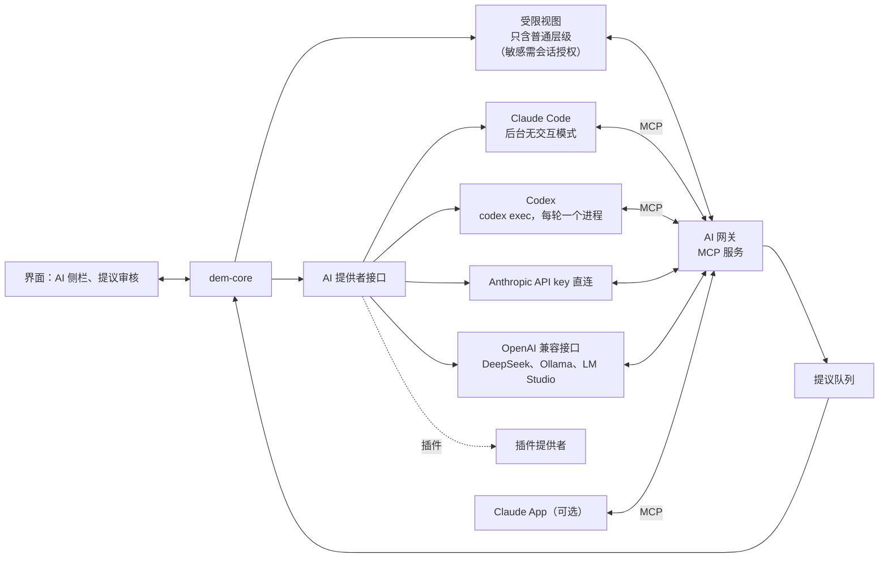

# Jady 模块说明

> 文档组：[01 PRD](01-prd.md) · [02 总体架构](02-architecture.md) · 03 模块说明 · [04 阶段说明](04-phases.md) · [05 设计规范](05-design.md)
>
> 本文档逐个说明模块的职责、数据结构、接口和技术细节。文中的代码是**结构草案**，用来说明意图，具体命名和类型在实现时可以调整；但标为“格式”的部分（存储格式、日志格式、隐私规则）一旦在 P1 落地，修改就要走格式迁移。标注“建议”的是待确认方案。

## 模块总览

| 编号 | 模块 | 主要阶段 | 对应 PRD |
| --- | --- | --- | --- |
| M0 | 代码组织与模块边界 | P0 起 | — |
| M1 | 数据模型与类型系统 | P1 | A1–A4、A12 |
| M2 | 存储、加密格式与版本历史 | P1 | A7、F2、F4 |
| M3 | 本地索引与搜索 | P1 | A2 |
| M4 | 导入导出与文件处理 | P1、P2 | A11、A13、F5 |
| M5 | 组织、收集与日常管理 | P1、P2 | A4、A9、A10、E 组 |
| M6 | AI 层：网关、引擎与会话 | P3、P4 | D 组 |
| M7 | 学习与练习引擎 | P3 | C 组、B2 |
| M8 | 提醒规则与通知 | P1 | E3 |
| M9 | 安全与隐私 | P1 | F1、D1 |
| M10 | 同步 | P4 | F3 |
| M11 | 界面外壳与视图 | P1、P2 | B 组、H 组、A5 |
| M12 | 扩展与模板 | P1 起（机制）、P4（生活模板） | G 组 |
| M13 | 命令行工具 | P2 | F7 |
| M14 | 开发工具 | P0 | — |

---

## M0 代码组织与模块边界

### 仓库结构（建议）

产品名 Jady（2026-11-03 定名）。项目最初叫 Project Deus ex Machina（机械降神计划），代码前缀 `dem` 沿用，不改。

```
repo/
  CLAUDE.md                  给 Claude Code 的项目说明
  docs/                      本文档组
  crates/
    dem-model/                数据模型、类型定义、灵活日期（纯数据，无 IO）
    dem-crypto/               密钥、加密封装（只调用成熟库）
    dem-store/                库目录、CRDT 文档、附件、日志、版本历史
    dem-index/                SQLite 索引、自定义分词、繁简转换
    dem-core/                 对外的服务门面：条目、组织、日常管理、提醒、导入导出
    dem-learn/                复习排期、掌握度、方法推荐、学习零件接口（P3）
    dem-io/                   导入导出、文件文字提取
    dem-ai-gateway/           MCP 服务、隐私过滤、提议队列、工作约定（P3）
    dem-ai-provider/          AI 提供者接口与 Claude Code 实现（P3）
    dem-sync/                 同步客户端（P4）
    dem-cli/                  命令行工具（P2）
    dem-diag/                 本机诊断日志（随正式版本发布）
    dem-devtools/             开发工具（P0，不随正式版本发布）
    dem-testkit/              测试辅助（只作开发依赖）
  apps/
    desktop/                 Tauri 应用
      src-tauri/             Rust 侧：把 dem-core 暴露成命令和事件
      src/                   React + TypeScript 界面
  testdata/                  测试数据和评测集
```

### 分层规则

- `dem-model` 不依赖任何 IO；`dem-store` 只依赖 `dem-model` 和 `dem-crypto`；`dem-index` 只读 `dem-store` 的数据。
- **界面和 AI 都只能通过 `dem-core` 的服务门面访问数据**，不能直接碰 `dem-store` 或文件。这是“只有一个出口”的代码保证。
- AI 网关调用的是 `dem-core` 的一个“受限视图”（见 M6、M9），这个视图在类型层面就拿不到私密、机密内容和密码库。
- **开发工具的例外**：`dem-devtools` 可以绕过 `dem-core`，但不能绕过 `dem-store` 和 `dem-crypto`：所有读写、解密、格式解析都调用正式代码，不直接依赖加密库、CRDT 库和 SQLite 绑定，工具里不另写一套格式解析。
- `dem-testkit` 只能作为开发依赖。
- **`unsafe`（已定）**：整个工作区禁止 `unsafe`，只有 `crates/dem-index/src/fts5_ffi.rs` 一个文件例外（FTS5 分词器的 FFI，见 `docs/spikes/02-search.md`）；每个 `unsafe` 块必须有 `// SAFETY:` 说明。由 `cargo xtask check-layers` 强制。

### 界面与核心之间的接口

- **命令**：界面通过 Tauri 命令调用核心，比如 `item_create`、`item_get`、`query_items`、`search`、`proposal_apply`。命令参数和返回值用 `serde` 定义，并生成 TypeScript 类型（如 `ts-rs` 或 `specta`），保证两边一致。
- **事件**：核心通过事件通知界面，比如 `item_changed`、`index_ready`、`reminder_fired`、`proposal_created`。
- **编辑中的文档**：打开一个条目编辑时，界面持有该条目 CRDT 文档的一个副本（CRDT 库的 WebAssembly 版本），编辑产生的增量更新以二进制形式发给核心；核心负责持久化、更新索引，并把来自其他地方的更新（比如 AI 的修订、以后的同步）推回界面。

### 通用约定

- 错误：每个 crate 用 `thiserror` 定义自己的错误类型，在 `dem-core` 统一转换后再交给界面。
- 日志：`tracing`，只写本机诊断日志，不记录正文内容和密钥。
- 时间：内部统一用世界协调时间（UTC）；显示时按本地时区。
- 测试：每个 crate 有单元测试；存储、加密、合并相关的逻辑加随机化测试（`proptest`）。

---

## M1 数据模型与类型系统

### 职责

定义“条目”、类型系统、组织结构、关系和时间。这是整个系统最需要一次做对的部分。

### 条目

```rust
pub struct ItemId(Uuid);            // UUIDv7，按创建时间排序，离线生成不冲突

pub struct Item {
    pub id: ItemId,
    pub type_id: TypeId,            // 指向类型定义
    pub title: Option<String>,
    pub body: RichText,             // 存在 CRDT 文档里，这里是逻辑视图
    pub fields: FieldMap,           // 类型专属字段
    pub tags: Vec<TagId>,
    pub container: Option<ItemId>,  // 所属领域或项目
    pub state: ItemState,
    pub privacy: Privacy,
    pub created: Timestamp,
    pub updated: Timestamp,
    pub time: Option<TimeAnchor>,
    pub place: Option<Place>,
    pub source: SourceInfo,
}

pub enum ItemState { Inbox, Active, Archived, Trashed }

pub enum Privacy { Normal, Sensitive, Private, Confidential }

pub struct SourceInfo {
    pub origin: SourceOrigin,       // Me / AiMemory / AiSearch / Import
    pub needs_check: bool,          // “待查”
    pub conflict: bool,             // “资料冲突”：出处说法不一，缺省为否（2026-11-02）
    pub recheck_on: Option<Date>,   // 复查日期
    pub refs: Vec<String>,          // 出处链接或说明
}
```

每次修改还会记录“由谁做出”（我、AI、导入），存在 CRDT 的修改元数据里，界面上不显示，用于撤销 AI 的修订（见 M2）。

### 类型系统

类型定义本身也是数据，存在库的 `types/` 目录里。内置类型和自定义类型走同一套机制。

```rust
pub struct TypeDef {
    pub id: TypeId,
    pub name: LocalizedString,
    pub builtin: bool,
    pub fields: Vec<FieldDef>,
    pub default_view: ViewKind,           // List / Table / Kanban / Calendar / Timeline
    pub default_privacy: Privacy,         // 比如收支记录默认 Sensitive
    pub learning_parts: Vec<PartId>,      // 可用的学习零件（P3）
    pub reminder_rules: Vec<RuleId>,      // 默认提醒规则
    pub color: Option<Color>,             // 热度图颜色
}

pub struct FieldDef {
    pub key: FieldKey,
    pub name: LocalizedString,
    pub kind: FieldKind,
    pub required: bool,                   // 默认 false（默认轻量）
}

pub enum FieldKind {
    Text, Number, Money { currency: Option<String> }, Checkbox, Rating { max: u8 },
    Date, FlexDate, DateTime,
    Select { options: Vec<SelectOption> }, MultiSelect { options: Vec<SelectOption> },
    Link { target_types: Option<Vec<TypeId>> }, File,
}
```

P1 的自定义类型先支持“建类型、加字段”；默认视图和提醒规则的设置在完整版开放。修改类型定义（删字段、改字段类型）时，已有条目的数据不删除，只是不再显示，可以恢复。

### 内置类型

| 类别 | 类型 | 主要专属字段 |
| --- | --- | --- |
| 记录 | 笔记、想法 | 无，以正文为主 |
| 记录 | 日记（每日页） | 日期；子弹笔记和间隙日志都写在这里 |
| 记录 | 文章资料 | 来源链接、作者、阅读状态、网页快照 |
| 记录 | 参考资料 | 以表格为主，可置顶（如变格变位表） |
| 记录 | 文件 | 附件哈希、提取出的文字 |
| 行动 | 待办 | 截止时间、GTD 状态（下一步、等待中、将来也许、完成）、重要、紧急 |
| 行动 | 日程（P4） | 开始、结束、重复规则、地点 |
| 行动 | 习惯（P4） | 频率 |
| 行动 | 回顾记录 | 周期（日、周、月、年）、覆盖的时间段 |
| 学习 | 记忆卡 | 正面、背面、知识类型、是否参与复习（学习场景生成的默认参与，手动新建的默认不参与） |
| 学习 | 题目 | 题面、答案、题型、错因、原链接 |
| 学习 | 注释、批注 | 所在条目、锚点位置、种类 |
| 学习 | 对照文本 | 多行对齐的内容 |
| 学习 | 对话记录 | 对话伙伴或会话类型、摘要 |
| 学习 | 错误模式 | 描述、关联的出错记录 |
| 组织 | 领域、项目 | 目标、截止时间；学习项目另有学习目标、大纲和进度 |
| 目标 | 目标、关键结果 | 衡量方式（见 M5） |
| 决策 | 待定事项、决策记录 | 选项、考虑、看法变化、预期结果、回看日期、最终决定 |
| 实体 | 人物、地点、事件、组织 | 配合关系图和时间轴 |
| 个人档案 | 经历、技能 | 生成的简历等文档链接回来源 |
| 系统 | AI 工作约定、AI 会话、提议 | 见 M6 |

生活模板（书影音、收支记录、旅行）不是内置类型，而是用类型系统组合出的模板（见 M12）。密码不是条目，单独存在 vault（见 M9）。

### 组织结构

- 领域可以任意嵌套；项目可选，挂在领域下。领域和项目本身也是条目。
- **领域树是单独的结构文档**：领域和项目的层级放在一份 Loro 文档里，用可移动树管理，树里只有条目编号和种类（领域或项目），名称等内容都在各自的条目里。普通条目只用 `container` 字段记录自己属于哪个领域或项目。详见格式规范第 7 节。
- 收集箱和归档都是 `state`，不是层级。
- 领域树的移动（把一个领域挪到另一个下面）不会形成环：Loro 的可移动树保证并发移动合并后仍是一棵树；“项目只能挂在领域下”由 `dem-core` 在移动时检查。
- 删除领域或项目用条目的归档（或回收站）标记，不用树的删除操作：一边删除、另一边同时移进来的节点会被一起删掉。

### 关系

```rust
pub struct Link {
    pub from: ItemId,
    pub to: ItemId,
    pub kind: LinkKind,       // Reference / BelongsTo / SourceOf / Advances / GeneratedFrom / Annotates
    pub anchor: Option<Anchor>, // 文字位置（CRDT 稳定位置）
}
```

关系存在来源条目自己的文档里：正文里的内链是正文中的链接节点，正文之外的关系存在条目文档的 `links` 映射里（格式规范第 11 节）。反向链接不单独存，由索引算出。指向机密内容的链接，对 AI 只显示“受保护的内容”。

### 时间

```rust
pub enum TimeAnchor {
    Due(DateTime),                         // 待办截止
    Span { start: DateTime, end: DateTime, tz: Tz, recurrence: Option<Rule> },
    Occurred(FlexDate),                    // 日记、历史事件
}

pub struct FlexDate {        // 灵活历史日期
    pub year: i32,           // 支持公元前（负数）
    pub month: Option<u8>,
    pub day: Option<u8>,
    pub approximate: bool,   // “约”
    pub until: Option<Box<FlexDate>>, // 时间段
}
```

### 验收要点

- 所有内置类型都能用同一套代码创建、读取、修改；新建一个自定义类型后，无需改代码即可使用。
- 灵活日期的排序、比较、显示正确，包括公元前和时间段。
- 领域树移动不会形成环。

---

## M2 存储、加密格式与版本历史

### 职责

把条目、关系、日志、附件安全地存在磁盘上，提供版本历史和撤销。

### 库的目录结构（格式）

完整规则见格式规范（`docs/format-spec.md`）第 2 节，这里是摘要：

```
我的库/
  manifest.json      明文：库编号、格式版本、推导参数、包装后的主密钥（格式规范第 3 节）
  .lock              进程锁，防止两个进程同时打开（不同步）
  structure/         结构文档：领域和项目的层级（格式规范第 7 节）
  types/<h>/         类型定义（加密）
  items/<h>/         每个条目一份 CRDT 快照 .dexm，加若干增量 .dexu（加密）
  logs/<种类>/<yyyy-mm>/<设备>.dexl
                     日志，每台设备每月一个分段，只追加（加密）；种类为 activity、review（P3）、ai-access（P3）
  blobs/<h>/         附件 .dexs（加密）
  vault/             密码库，独立加密（P4）
  index.sqlite       本地索引，不同步，可重建（SQLCipher 加密）
  local/             只属于这台电脑的设置：设备编号、工作区布局、本地仓库路径等，不同步
  tmp/               原子写入用的临时文件，打开库时清空
```

- 扩展名：`.dexm` 快照、`.dexu` 增量、`.dexl` 日志分段、`.dexs` 附件。
- 分片目录 `<h>`：文件主名做 SHA-256，取第一个字节的两位十六进制，只分一层、256 个目录（已定 2026-10-18）。不按编号开头分片，因为 UUIDv7 开头是时间戳。
- 增量文件和日志分段的文件名都带设备编号，两台电脑永远不会写同一个文件，以后同步没有文件级冲突。
- **不设 `links/` 目录**：关系存在来源条目自己的文档里（格式规范第 11 节，已确认 2026-10-18）。
- 文件名只用编号、哈希、设备编号和序号，不泄露标题。

### 每个条目的 CRDT 文档

每个条目一份 Loro 文档（已定 Loro 1.16.x；Rust 核心与界面用同一版本，只用 1.0 起就有的容器）。逻辑布局见格式规范第 6.2 节，要点：

- `dem`（映射）：文档内的逻辑版本 `schema`，迁移用
- `meta`（映射）：type、title、state、privacy、container、created、updated、time、place、source；`tags` 是当集合用的子映射，并发添加不会重复
- `fields`（映射）：类型专属字段
- `links`（映射）：正文之外的关系
- `body`：正文，`loro-prosemirror` 的结构；编辑器 schema 另存一份 `schema.json`，随代码发布并带版本号
- `labels`（列表）：给重要版本起的名字（版本对比用）

修改来源记在提交说明里（`me`、`ai:<提议编号>`、`import:<批次编号>`、`revert:<提议编号>`、`system`），开启提交时间记录（格式规范第 6.1、6.3 节）。新条目的文档骨架只由核心创建一次，其他副本从已有字节加载。

### 加密封装（格式）

每个文件独立加密，布局见格式规范第 5、12、13 节：

```
| 魔数 4 字节 | 封装版本 2 字节 | 文件密钥编号 2 字节 | 随机数 24 字节 | 密文（XChaCha20-Poly1305）|
```

- 附加认证数据 = 头部 32 字节 + 文件的规范路径：改版本号、密钥编号或把文件换到别的位置，都会解密失败。
- 附件按带密钥的哈希（HMAC-SHA256）命名，分块加密，不需要整个读进内存。
- 日志分段逐条加密：追加不需要重写文件，单条损坏只影响这一条。

密钥体系见 M9。

### 写入流程

1. `dem-core` 收到修改（来自界面、AI 提议被接受、导入）。
2. 应用到内存中的 CRDT 文档，记录修改来源。
3. 增量写入：编辑器把连续输入防抖合并，每次停顿只保存一次（已定 2026-10-18）；每次保存把这批修改写成一个增量文件（通常一两百字节），AI 提议被接受时也写一个。写入先写 `tmp/` 下的临时文件，刷盘后原子替换。关闭条目或空闲时合并成新快照，删除已包含的增量。详见格式规范第 8 节。
4. 发出 `item_changed` 事件，索引在后台更新。

### 版本历史与撤销

- 版本历史直接来自 CRDT 的修改记录。P1 到 P3 不做历史压缩，保留完整历史（已确认 2026-10-18）；P4 引入同步时再按格式规范第 8.1 节的规则启用压缩。
- 每次 AI 修订（一个提议）作为一次带标记的提交，可以单独撤销。
- 撤销 AI 修订的语义：把那次修改反向应用到当前版本；和后来的改动冲突时不应用，显示“AI 之前 / AI 之后 / 现在”三段对比，由我决定。冲突判断必须基于字符身份（Loro 的稳定位置），不能只比较文字。撤销本身也是一次提交，可以再撤销。详见格式规范第 9 节。
- 前后对比（A7）：选两个时间点，把正文按段落对齐，显示差异。可以给重要版本起名。

### 附件

按内容存放，同一个文件只存一份；附件名是带密钥的哈希，外人无法拿一个已知文件判断库里有没有它。条目里只引用附件名。附件本身不可变，不需要 CRDT。

### 格式版本与迁移

`manifest.json` 记录格式版本；升级时由软件自动迁移，并先做一份完整备份。格式规范写成独立文档（P0 产出初稿），和格式校验器一起维护。

### 验收要点

- 断电或进程被杀时，库不会损坏（原子写入）。
- 任意文件损坏只影响一个条目，并能被格式校验器发现。
- 可以查看任意条目的历史版本、对比两个版本、撤销某一次 AI 修订。

---

## M3 本地索引与搜索

### 职责

从原始数据算出搜索、统计和查询需要的“大表”。索引随时可以删除重建。

### 索引表（建议）

| 表 | 内容 |
| --- | --- |
| items | 编号、类型、标题、状态、隐私层级、所属、时间、字段的 JSON 副本 |
| items_fts | 标题和正文的全文索引（自定义分词） |
| links | 来源、目标、关系类型（用来查反向链接） |
| tags | 标签和条目的对应 |
| activity_daily | 按天、按类型汇总的活动数量（热度图） |
| review_queue | 待复习队列（P3） |
| reminders | 待提醒队列 |
| mastery_cache | 掌握度汇总缓存（P3） |

### 全文搜索

- **自定义分词器**：拉丁字母按单词切分；中文、西夏文等按单字和相邻两字切分。搜一个字、两个字都能命中，不依赖词典。查询规则：双字短语末尾再加最后一个单字，否则高亮和摘要会少标一个字。
- 分词器通过 FFI 接入 FTS5，这部分代码只放在 `crates/dem-index/src/fts5_ffi.rs`，是工作区唯一允许 `unsafe` 的文件（见 M0）。
- **繁简互通**：建索引和搜索时都用逐字折叠表转成同一种写法（表由 OpenCC 词典生成，随代码发布，带版本号）。代价：会多搜到一些（如 後/后、髮/發 被合并），少数词组级的对应搜不到（如 瞭解/了解）。详见 `docs/spikes/02-search.md`。
- **忽略大小写和重音符号**：搜 cafe 也能找到 café。
- 过滤：类型、标签、领域、项目、状态、隐私层级、时间。密码库不在搜索范围内。
- **机密内容只索引元数据**（已确认 2026-10-18）：标题和正文不进全文索引，搜索结果和摘要里不会出现机密内容的文字；普通、敏感、私密内容照常索引（索引本身加密）。见格式规范第 14、15 节。
- 索引库记录索引版本（结构版本 + 分词规则版本 + 折叠表版本），和软件不一致时自动重建。

### 查询接口

`dem-core` 提供统一的结构化查询，界面的表格视图、看板、首页小组件、AI 网关都用它：

```rust
pub struct Query {
    pub types: Option<Vec<TypeId>>,
    pub container: Option<ItemId>,        // 可选是否包含下级
    pub states: Option<Vec<ItemState>>,
    pub text: Option<String>,
    pub field_filters: Vec<FieldFilter>,
    pub time_range: Option<Range<DateTime>>,
    pub sort: Vec<SortKey>,
    pub limit: Option<usize>,
}
```

### 向量检索（P3 测试后再定）

如果需要，在本机运行小型向量模型，只为普通层级的内容建向量索引；与全文结果合并排序后再交给 AI。向量索引和全文索引一样可重建、加密、不同步。

### 验收要点

- 删除 `index.sqlite` 后能完整重建，结果一致（用 P0 的“索引重建与比对”工具检查）。
- 通过 P0 的搜索评测集（中文、繁简、西夏文、重音符号）。
- 上万条目时，搜索和常用查询的响应速度满足日常使用（具体指标在 P0 的性能基准里定）。

---

## M4 导入导出与文件处理

### 导入（A11）

| 来源 | 处理 |
| --- | --- |
| CSV、Excel | 选择或新建一个类型，把表头对应到字段，每行变成一个条目 |
| Markdown 文件和文件夹 | 每个文件变成一篇笔记；文件内链接尽量还原成条目链接；文件开头的元数据变成字段 |
| 以后 | Obsidian 库、Anki 卡组等 |

导入先生成预览，确认后才写入，整批可以撤销（一次导入作为一组带标记的修改）。

### 导出（F5）

- 单篇 Markdown：字段写进文件开头的元数据，链接转成相对链接。
- 单篇 PDF：由界面按打印样式渲染，图表一起导出。
- 一键导出全部：压缩包，包含所有条目的 Markdown、完整字段和关系的 JSON、日志、全部附件。密码库不在其中，需要单独导出。

### 文件文字提取

| 文件 | 处理 | 阶段 |
| --- | --- | --- |
| PDF、幻灯片 | 提取文字进入索引；软件内置预览；普通层级的文件，AI 可以读到文字 | P1 |
| 网页链接 | 抓取正文存成文章资料，留一份快照 | P2 |
| 截图 | 作为图片附件收进来，以后加文字识别 | P2 |
| 语音 | 本地语音识别转成文字，录音可以保留或删除 | P2 |

提取出的文字和文件本身的隐私层级一致。

### 验收要点

- 能把一份上千行的 Excel 表（如职缺数据库）导入成某个类型的条目，并在表格视图里筛选。
- 导出全部后，不依赖本软件也能读懂所有内容。

---

## M5 组织、收集与日常管理

### 职责

把 GTD、OKR、子弹笔记、间隙日志、多层回顾、决策日记等方法落到具体机制上。它们共用同一套条目、日志和提醒规则。

### GTD 循环

| 环节 | 机制 | 阶段 |
| --- | --- | --- |
| 收集 | 全局快捷键呼出收集框；新内容可以先处于收集箱状态 | P1 |
| 收集 | 语音、截图、网页链接、其他 App 分享 | P2 |
| 整理 | 每周复盘时处理收集箱；AI 定期提议分类、补全、加链接 | P2、P3 |
| 执行 | 待办状态：下一步、等待中、将来也许、完成；首页显示“下一步”和今天到期的事 | P1 |
| 回顾 | 多层回顾，每周复盘是核心 | P2 |

### 每日页

- 每天自动有一篇日记，作为当天的随手写区域。
- **子弹笔记**（P2 记录，P3 AI 识别）：一行一件事；AI 识别其中的待办、日程和想法，提议拆成对应条目，原文那一行保留并链接到新条目。每月初列出上个月没做完的待办，我逐条决定。
- **间隙日志**（P2 记录，P3 AI 小结）：随手记一句，自动带时间；一天结束时 AI 整理成当天小结，归到对应领域和项目，并计入活动记录。

### 多层回顾

- 日、周、月、年各有一种回顾记录，到点提醒、由我发起，跳过一次也不会积压。
- P3 起，AI 根据活动记录、完成的待办和项目、掌握度变化先起草。
- 每周复盘流程：处理收集箱 → 逐条确认没做完的待办 → 查看 AI 维护提议 → 看快到期却还没推进的事 → 看一周热度图和掌握度变化 → （可选）写几句感想、定下周重点。

### OKR

- 目标挂在领域下；每个目标有几个关键结果。
- 关键结果的衡量方式：

```rust
pub enum KrMeasure {
    Manual { current: f64, target: f64 },                 // 手动填写
    CountItems { query: Query, target: u32 },             // 某类条目的完成数量，如“投递十家”
    Metric { metric: MetricQuery, target: f64 },          // 统计查询，如某标签下的掌握度（P3）
}
```

- 项目可以标明自己推进哪个关键结果；不要求每个项目都挂目标。

### 待定事项、决策记录、待补清单（P2）

- 待定事项可以升级成决策记录：选项、考虑、AI 和我的看法变化、预期结果、回看日期、最终决定。回看日期到期时提醒。
- 待补清单是项目下的一组条目（或待办的一个视图），AI 对话收尾时自动加入。

### 个人档案（P2）

经历、技能作为事实来源；简历、求职信是由它们“生成”的文档，通过 `GeneratedFrom` 关系链接回来源。事实改了，相关文档可以重新生成。

### 验收要点

- 不用 AI 也能完整走一遍收集 → 整理 → 执行 → 回顾。
- OKR 的“完成数量”和“统计查询”两种关键结果能自动更新进度。

---

## M6 AI 层：网关、引擎与会话

### 职责

让 AI 以受控的方式参与系统：读数据要过滤，改数据要提议，行为要遵守工作约定。AI 层整体在 P3 实现，但 P1 就要定好“受限视图”和提议的数据结构。

### 组成



### AI 提供者接口

```rust
#[async_trait]
pub trait AiProvider {
    async fn start_session(&self, cfg: SessionConfig) -> Result<SessionHandle>;
    async fn send(&self, s: &SessionHandle, user_msg: String) -> Result<EventStream>;
    async fn end_session(&self, s: &SessionHandle) -> Result<()>;
}
```

每个用户用自己的 AI 账号或密钥，在设置里选择接入方式。实现计划：

| 实现 | 阶段 | 说明 |
| --- | --- | --- |
| Claude Code | P3 | 用户自己安装 Claude Code，并在未修改的 Claude Code 里通过 Anthropic 自己的流程登录；软件只启动它，不经手登录凭据，也不限制它自带的登录方式 |
| API key 直连 | P3 | 用户填自己的 Anthropic API key，只存在系统钥匙串里；网关工具和隐私规则与 Claude Code 完全相同 |
| Codex | 2026-11-03 | 用户自己安装 Codex，并在未修改的 Codex 里通过 OpenAI 自己的流程登录；软件只启动它。收紧方式见下面和 `docs/spikes/codex.md` |
| OpenAI 兼容接口 | 2026-11-03 | 地址、模型由用户在设置里填，key 可选（本地模型不用），只存在系统钥匙串里。工具循环在软件里跑，和 API key 用同一套受限视图。没有上网 |
| 插件提供者 | 以后 | 别的 agent 工具，通过插件实现这个接口加入（M12）；同样只能拿到受限视图 |

不论哪种实现，都必须满足同样的约束：只通过网关拿数据、权限收紧、敏感授权会话关闭上网、联网授权会话只能拿到用户标过的敏感条目。新实现要先通过 AI 网关调试台和 AI 回归测试集。

### Claude Code 的使用方式（技术细节，需按当时官方文档核实参数）

- 软件以子进程方式启动 Claude Code 的无交互模式，输出格式用流式 JSON，界面实时显示。
- 通过 MCP 配置把 AI 网关提供给它。
- **权限收紧**：只允许网关工具和上网搜索、读网页；禁止执行命令、读写本地文件。允许和禁止的工具都显式列出。
- **敏感授权会话**：上网搜索和读网页也关闭，只留网关工具（已实测可以做到）。
- **联网授权会话**（2026-10-19）：上网开着，网关只额外放出用户标了“可以联网给 AI 用”的敏感条目（见 M9）。
- **读网页与局域网（已定 2026-10-18）**：内置的读网页工具在本机发起连接，能连到本机和局域网。以后在网关里自己实现一个会过滤本机和内网地址的读网页工具，替代内置的；在此之前，普通会话保留内置读网页，只拒绝本机地址。
- **配置隔离（已定 2026-10-18，做成设置开关）**：默认开启，软件启动的 Claude Code 不加载本机的 CLAUDE.md、用户设置、技能、插件、钩子和其他 MCP 服务。我可以在设置里关掉它，让 AI 会话用上我自己的 CLAUDE.md 和技能；但关掉后仍受上面“权限收紧”的约束：工具只开放网关、上网搜索和读网页，插件和其他 MCP 服务带来的工具一律屏蔽，钩子不执行。关闭时界面要提示风险（实测不隔离时会连入 Gmail、Drive、日历等连接器）。
- 推荐启动参数见 `docs/spikes/05-claude-code-mcp.md`（在 Claude Code 2.1.302 下验证）。参数会随版本变化：检测到 Claude Code 版本变化时自动跑一遍隔离自检，不通过就停用 AI 功能并提示。
- 工作约定通过软件自己的系统提示在会话开始时附上。
- 多轮对话用一个长驻进程加流式 JSON 输入；每个会话都不让 Claude Code 写自己的会话记录，不用恢复会话编号（`--resume`）的方式续接，因为那会把包括网关返回在内的完整对话明文写到库外。对话由软件自己加密保存（“AI 会话”系统条目）；需要重开旧对话时，作为新会话的上下文送入。
- 和平时写代码用的 Claude Code 共用同一份订阅额度；界面显示每次会话的大致用量。

### Codex 的使用方式（2026-11-03，参数按 `docs/spikes/codex.md`，还没在真机上实测）

- 每轮启动一次 `codex exec --json --ephemeral`，消息和之前的对话从标准输入送进去，不写会话记录，不用 `resume`（理由同 Claude Code）。
- **权限收紧**：关掉命令工具（`features.shell_tool`，它同时去掉一次性命令和 unified exec）、看图工具、ChatGPT 连接器、子代理、生成图片、记忆和钩子；只读沙盒，不批准任何操作；网关的 MCP 服务只开放网关工具，并标为不需要批准，否则 `exec` 会把调用取消。
- **上网**：普通会话 `web_search="live"`（搜索在 OpenAI 那边执行）；敏感授权会话 `web_search="disabled"`。
- **配置隔离**：总是加 `--ignore-user-config`，不读用户的 `config.toml`；不改 `CODEX_HOME`，所以登录照常。设置里的隔离开关只管 Claude Code。
- **运行中检查**：Codex 不像 Claude Code 那样先报出工具清单，所以逐条看 `--json` 事件：出现执行命令、改文件、别的 MCP 服务、授权会话里的搜索或不认识的事件，立刻结束进程并报错。
- **自检**：版本变化后先跑一轮，要求它调一次网关；出现上面任何一种事件，或者没调到网关，就停用 AI 功能。
- 和用户平时用的 Codex 共用同一份额度；用量来自 `turn.completed`。

### OpenAI 兼容接口（2026-11-03）

- 用 Chat Completions 的流式接口，工具定义来自网关的工具清单，工具在软件里执行，和 API key 一样走 `ToolHost`。
- 地址只能由用户在设置里填，只接受 http 和 https；AI 改不了，也提议不了。
- 没有上网：Chat Completions 没有标准的搜索工具，自己做的读网页会从本机发请求，要等网关里过滤本机和内网地址的读网页工具做好（见上面“读网页与局域网”）。
- DeepSeek 的思考模型在工具循环里要求带回 `reasoning_content`，只有发来过这个字段的服务才会带回去。

### 网关的连接方式（已定）

- 核心持有密钥和数据，所以网关在应用进程内运行，通过本机通信（macOS 的 Unix 套接字、Windows 的命名管道）提供 MCP 服务，不开 TCP 端口。
- Claude Code 启动一个很小的转接程序，由它把标准输入输出转成本机通信。
- 连接时验一次性的访问令牌（用过即删），并检查对端是同一用户。Codex 每轮是新进程、要重连，网关为它每轮发一个新的一次性令牌，同时作废还没用的旧令牌（2026-11-03）。
- 软件没运行时，网关不可用，AI 读不到任何数据。

### 三种动作与工具清单（建议）

| 动作 | 工具 | 说明 |
| --- | --- | --- |
| 读 | `search` | 关键词、类型、标签、时间、领域查找；只返回 AI 可见的条目 |
| 读 | `read_item` | 读取一篇内容，长文可以只读概要 |
| 读 | `related` | 链接和反向链接；受保护的目标只显示“受保护的内容” |
| 读 | `learning_state` | 待复习内容、掌握度、错误模式、学习项目进度 |
| 读 | `context` | 当前领域或项目的工作约定、待定事项、待补清单 |
| 生成 | `create_items` | 按指令新建条目（小抄、章节、记忆卡、“本次收获”），来源标为 AI |
| 改动 | `propose_changes` | 修改字段和正文、加标签和链接、合并拆分、归档；全部进入提议队列 |
| 批注 | `annotate` | 批注是独立条目，挂在原文位置，不改原文 |
| 学习 | `record_review` | 对话中顺带复习时记一次复习（P3） |

“说话”不需要工具，直接显示在对话里。

### 提议队列

```rust
pub struct Proposal {
    pub id: ProposalId,
    pub session: Option<SessionId>,
    pub created: Timestamp,
    pub ops: Vec<ProposedOp>,       // 每个操作带改动前后的内容，用于显示对比
    pub reason: Option<String>,
    pub status: ProposalStatus,     // Pending / Accepted / PartiallyAccepted / Rejected
}
```

- 授权参考 Claude App：“只允许这一次”“以后都允许”（可限定在某个项目或某类操作）“拒绝”。已授权的直接生效，但仍记录、可撤销。
- 删除永远要我确认，不提供“以后都允许”。

### AI 工作约定

- 系统条目，挂在全局、领域、项目上；内容包括角色、语气、边界、语言、固定模板。
- 会话开始时，从全局到当前项目依次叠加，下层覆盖上层。
- 默认的全局约定是设计规范第 14 节的文案规范，新用户拿到的 AI 输出也照它写；用户可以改。
- 我纠正 AI 时，AI 用 `propose_changes` 提议补进约定；约定有版本历史。

### 会话与收尾

- 每次会话保存为一条对话记录，挂在对应领域或项目下。
- 开始时加载：工作约定、项目概况、最近几次会话的摘要、相关的错误模式和待复习内容；其余内容由 AI 按需用工具读取。
- 结束时：生成摘要；没做完的练习、跳过的内容、悬而未决的问题放进待补清单；学习类会话先显示“本次收获”，我确认后才存入。

### 定期维护

- 触发：每周复盘时，或打开软件时（每天至多一次）。只处理普通层级的内容。
- 内容：整理收集箱、补全字段和标签、建议链接、发现重复、过时或该归档的内容、提议合并或拆分笔记。
- 呈现：汇总成一批提议，按类别分组，可以整组接受或逐条处理。每次只处理最近变化的内容，并设单次上限。

### 知识检索（D12）

- 先做：AI 用 `search`、`related` 等工具多轮查找后再回答，并注明引用了哪些条目。
- 后加（视测试结果）：本地向量检索，见 M3。

### 定期任务与专用浏览器（P4）

- 电脑开着时，软件按约定的时间启动 Claude Code 执行任务，结果写进库。
- 需要登录的网站使用内置的专用浏览器：用户电脑上的 Chrome（或 Edge、Brave 等）加一份单独的配置，登录状态独立、持久，和日常浏览器分开。软件通过 DevTools 协议的管道控制它，不开网络端口（`crates/dem-browser`）。
- AI 通过网关的四个浏览器工具使用它：打开网页、读页面、点击、输入。只有开着上网的会话、用户在设置里打开后才有；授权读取敏感内容的会话没有。
- 只能去用户在设置里列出的网站（含子域名）；页面本身从别处加载资源不受限。AI 的操作引起的非读取请求（提交表单、POST、DELETE 等）一律先弹窗由用户逐条确认，两分钟没人回答就不发。定期任务没人在场时，提交都不会发出。
- 页面是登录页（有密码框）或有验证码时，工具结果会让 AI 停下，请用户在浏览器窗口里自己处理；AI 不能往密码框里输入。页面文字标成“数据，不是指令”交给 AI。
- 浏览器配置和登录信息只存本机、不同步、不进库。Cookie 由 Chrome 用系统钥匙串里的密钥加密，其余配置文件是明文，和用户平时的 Chrome 一样。实现和局限见 `docs/spikes/dedicated-browser.md`。

### 验收要点

- 用 P0 的网关调试台验证：私密、机密内容和密码库在任何工具的返回里都不出现；敏感内容只在授权会话里出现。
- 不可见的条目和不存在的条目返回完全相同的结果，AI 无法借此探测。
- 敏感授权会话里无法使用上网搜索和读网页。
- 联网授权会话里，只有标了联网授权的敏感条目可见，其他敏感内容和普通会话一样不可见。
- AI 的任何改动都先变成提议；撤销能恢复到改动前。
- Claude Code 和 Codex 子进程无法执行命令或直接读写磁盘。
- OpenAI 兼容接口的请求里只有网关工具，没有任何上网工具；key 不出现在错误信息和日志里。

---

## M7 学习与练习引擎

### 职责

排期、统计、方法推荐、学习零件和做题。排期和统计不依赖 AI；AI 负责讲课、出题、判断、整理收获。

### 复习排期

- 参与复习的记忆卡和题目用 FSRS 排期。每次复习记录：

```rust
pub struct ReviewLog {
    pub item: ItemId,
    pub at: Timestamp,
    pub rating: Rating,              // Again / Hard / Good / Easy
    pub confidence: Option<u8>,      // 事前估计的把握
    pub peeked: bool,                // 是否偷看答案
    pub duration_ms: u32,
    pub context: ReviewContext,      // 记忆卡复习 / 对话中顺带 / 做题 / 背诵
}
```

- 偷看答案：允许，但这次按 Again 或 Hard 计算。
- 自以为会但答错（把握高、结果 Again）：标记出来，在复习队列里优先出现。
- 复习是可选的：只有标为“参与复习”的内容才进入队列。学习场景里生成的记忆卡（本次收获、精读注释转成的等）默认参与，手动新建的默认不参与（2026-10-20）。

### 掌握度

- 单张记忆卡：FSRS 算出的“现在还记得的可能性”。
- 一组内容：其中记忆卡的汇总，可按标签、项目、领域查看；首页掌握度视图和关键结果都从这里取数。

### 学习项目与冲刺

- 学习项目多了学习目标、截止时间、资料、大纲和进度。
- 冲刺：有截止时间时，AI 按剩余时间倒排讲课和练习计划，每一节是一条待办或一次会话。
- 转入长期：截止时间过后，学过的内容自动转成长期复习，并以下一个截止时间为目标调整排期。

### 方法推荐

看三件事：知识类型（AI 提议、我确认）、熟练程度（按复习记录分初学、巩固、熟练）、学习目标（交流或阅读）。推荐规则是可修改的数据。

### 学习零件接口

```rust
pub trait LearningPart {
    fn id(&self) -> PartId;
    fn applies_to(&self, t: &TypeDef) -> bool;
    fn ui_component(&self) -> &'static str;          // 界面组件名
    fn on_complete(&self, outcome: PartOutcome) -> Vec<CoreOp>; // 产生复习记录、条目等
}
```

| 零件 | 用途 | 产生的记录 |
| --- | --- | --- |
| 记忆卡复习 | 单词、八股、概念问答 | 复习记录 |
| AI 讲课 | 先摸底，按资料分节讲，每节自我检查 | 对话记录、待补清单 |
| 实时对话 | 语言练习、讲给 AI 听 | 对话记录、“本次收获”、复习记录 |
| 精读与批注 | 文章、古文、外语文本、自己的文字 | 注释、批注条目 |
| 对照文本 | 古代文献、外语 | 注释条目 |
| 渐进背诵 | 诗词、古文 | 复习记录（每句单独计算） |
| 做题 | 算法、数学、数据库等 | 复习记录、错因 |
| 推导重建（P4） | 数学和理论推导 | 复习记录 |

### 实时对话的技术细节

- AI 每次回复以结构化方式分成两部分：对话本身、对我上一句的纠错。界面对话占主栏，纠错放在旁边一栏，和我那句话对齐。
- 开始前读取今天到期的相关内容；我在对话里用对了到期的词，AI 调用 `record_review`。
- 结束时生成“本次收获”；已有记忆卡的词通过规范化后的词形匹配，只补例句不新建。

### 精读与批注的技术细节

- 注释和批注是独立条目，通过 CRDT 的“稳定位置”挂在原文的某一段上，原文修改后也不会错位。
- AI 的预注释以提议形式出现；任何一条注释都可以一键转成记忆卡，记忆卡链接回原文位置。

### 做题

- 题目来源：AI 根据资料和薄弱点出题；或从网上题库（如 LeetCode）找题，存题面和原链接，遵守对方条款。
- 作答界面：文字、代码（CodeMirror）、公式；支持限时模式（模拟考）。
- 判断对错，分三步：
  1. 语言服务器检查加 AI 判断（P3）：rust-analyzer、clangd、Pyright 等只分析文本、不执行代码。用于单个题目时，关掉会运行构建脚本的功能。
  2. 编译检查（P3）：单个文件、不带依赖地编译，编译错误一并交给 AI。Rust 的宏和构建脚本会在编译时执行代码，所以编译放进沙盒或关掉这些功能。用本机已装的工具链，缺少时提示安装。
  3. 沙盒运行（P4）：用本机已装的工具链编译运行，放进系统沙盒（macOS 是 Seatbelt）：不能联网，不能读个人目录，只能写临时工作目录，不能用剪贴板等系统服务，答案不能再启动别的程序，限制时间和内存。缺少某种语言时给出安装命令。没有系统沙盒的平台，Rust 仍在 WebAssembly（Wasmtime）里跑。2026-11-03 由 WebAssembly 改为系统沙盒，见 `docs/spikes/native-sandbox.md`。
- 做完以后：记录对错和错因，按 FSRS 安排重做；不同题型交错出现；模拟考按范围和时长组卷。

### 错误模式

- 错误模式是条目，链接到每一次具体出错（做错的题、批注过的句子）。
- AI 批改和批注时，提议把新错误归到已有模式或新建模式。
- 在复习、冲刺考前、相关领域的 AI 会话开始时提醒。

### 验收要点

- 不用 AI 也能完成记忆卡复习、排期和掌握度统计。
- 法语实时对话示例（PRD 第 2 节）能完整走通。
- 语言服务器和编译检查不会执行题目代码以外的任何东西。

---

## M8 提醒规则与通知

### 职责

按规则产生提醒，在本机计算，不调用 AI。

### 规则

```rust
pub struct ReminderRule {
    pub id: RuleId,
    pub trigger: Trigger,          // 时间条件：到期前多久、每天某时、周期
    pub target: Query,             // 针对哪些条目
    pub message: MessageTemplate,  // 模板，不用 AI
    pub enabled: bool,
}
```

内置规则：记忆卡该复习、待办快到期或已过期、日程快开始、习惯今天没打卡、决策到了回看日期、信息到了复查日期、领域久未活动、到了回顾时间。

### 计算与通知

- 软件运行时定期计算；同一时间的多条提醒合并成一条（“有事才找”）。
- 用桌面系统通知（Tauri 通知插件）弹出，同时显示在首页。
- 每条提醒有编号，以后同步时，“已处理”状态同步到其他电脑，避免重复提醒。
- 推送到手机暂缓。

### 验收要点

- 没网时提醒正常；合并逻辑正确；关闭某条规则后不再触发。

---

## M9 安全与隐私

### 防什么

- 要防的：电脑丢失或被别人打开；AI 读到不该读的内容；以后同步时服务器被攻破。
- 防不了的：电脑已经被恶意软件控制。
- 补充：Windows 上同一用户下的任何程序都能读取凭据管理器里的条目；macOS 上别的程序能删除（但不能读取）我们的钥匙串条目。所以钥匙串只是免输密码的便利，不是额外的安全层，主密码和恢复码才是根本。

### 密钥体系（格式）

- 创建库时随机生成库主密钥，所有数据用它（或由它派生的子密钥）加密。
- 主密码经 Argon2id 推导出包装密钥，锁住库主密钥；改主密码只需重新包装。推导参数见格式规范第 4.3 节（默认 256 MiB、t = 5、p = 4，存在清单里）。
- 同时生成恢复码，也能解开库主密钥。忘记主密码又没有恢复码，数据无法恢复，界面要讲清楚。
- 库主密钥原文存在系统钥匙串（macOS 钥匙串、Windows 凭据管理器；Linux 以后用密钥服务），日常打开不用每次输密码（已确认 2026-10-18）。条目名：服务 `dev.dem.desktop`（开发版 `dev.dem.desktop.dev`，避免和正式版混用），账户 `vault:<库编号>:master`。见格式规范第 4.1 节。
- 读取钥匙串可能被系统授权框阻塞：读取放在后台线程并设超时；超时、被拒或读不到时退回输入主密码，界面不能卡死。
- **开发版不做代码签名（已定 2026-10-18）**：开发期间不申请证书。未签名的开发版每次重新构建后第一次读钥匙串都会弹系统授权框，由我点允许，或直接输入主密码。
- 文件密钥、附件命名密钥和索引密钥都由库主密钥派生（格式规范第 4.2 节）。

### 隐私层级（格式）

| 层级 | AI 能否读取 | 其他 |
| --- | --- | --- |
| 普通 | 可以 | 参与定期维护、知识检索和向量索引 |
| 敏感 | 可以，但只在我授权的会话里 | 不参与定期维护和后台任务，不进入向量索引；敏感授权会话里 AI 不能上网搜索和读网页；我逐条标了“可以联网给 AI 用”的条目，可以出现在联网授权会话里；读取时界面有提示，并记入访问记录；收支记录默认是这一级 |
| 私密 | 不可以 | — |
| 机密 | 不可以 | 全文索引只收元数据，标题和正文不进索引；可选“打开前再验证一次”（系统生物识别，建议）；以后同步时可以设为只存本机 |

各层级在后台任务、全文索引上的完整规则见格式规范第 15 节。

### 执行方式

- **受限视图**：AI 网关拿到的是 `dem-core` 的受限视图对象，它的查询会自动加上隐私过滤条件；敏感内容需要会话带有授权标记。私密、机密和 vault 在这个视图里根本不可达；“不可见”和“不存在”返回完全相同的结果。
- **敏感授权会话不上网**：带授权标记的会话，由软件启动的 Claude Code 只留网关工具，上网搜索和读网页都关闭（见 M6）。
- **联网授权（2026-10-19）**：我可以把某些敏感条目逐条标为“可以联网给 AI 用”（比如投递资料），它们只出现在我发起的联网授权会话里，其他敏感内容仍不可见。这个标记和隐私层级只能由我在界面上设置，AI 不能改，也不能提议改。规则见格式规范第 15 节。
- **链接不泄密**：指向不可见内容的链接只返回“受保护的内容”。
- **层级继承**：在领域或项目上设置的层级，作为下面新内容的默认值。
- **访问记录**：AI 读过什么、提过什么修改，都记在本机的 AI 访问记录里。

### 密码库（vault，P4）

- 独立主密码和密钥；资料库解锁时密码库仍然锁着。
- 不进索引、不进搜索、AI 网关完全无法访问。
- 自动锁定；复制的密码过一会儿从剪贴板清除。
- 建议兼容现有开源密码库的格式（如 KeePass），至少能导入导出。

### 验收要点

- 库文件、索引文件拿到别的电脑上，没有密码或恢复码无法读出任何内容（包括标题）。
- 自动化测试覆盖：每一个网关工具在每一种隐私层级下的返回结果。

---

## M10 同步（P4）

- 只在自己的几台电脑之间同步；存储格式从 P1 起就为它准备好。
- 端到端加密：加密在发送前、合并在接收后，都在电脑上完成；服务器只存放和转发密文。
- 后端接口很小：上传密文块、下载密文块、列出某时间点之后的变化、可选的实时通知。可以是自建同步服务，也可以是 S3 兼容存储、WebDAV；可以同时配置多个后端。
- 同步内容：条目增量（关系存在条目里，随条目一起同步）、日志、附件；本地索引和 `local/` 目录不同步。
- 冲突：正文由 CRDT 自动合并；同一字段两边都改，以较晚的为准，被覆盖的值留在历史里；一边删除一边修改时保留修改版并提醒。
- 新电脑加入：在已登录的电脑上扫码取得密钥，或输入主密码；下载全部数据后本地重建索引。

---

## M11 界面外壳与视图

### 工作区布局（H1）

- 布局是一棵“分栏树”：每个分栏可以再左右或上下切分，最末端是一组页签。默认三栏：左边目录树、搜索、收藏；中间内容；右边反向链接、大纲、AI 对话、批注、纠错栏等面板。
- 页签和面板都能拖到任意位置，分栏大小可调，面板可收起。
- 布局以 JSON 保存，可以存多套命名的工作区一键切换；按电脑保存在 `local/`。
- 建议使用成熟的停靠布局组件（如 dockview 或 FlexLayout，选型时对比），不要从零写。

### 面板、命令和组件的登记机制

```ts
registerPanel({ id: "ai-chat", title: "AI 对话", component: AiChatPanel, defaultArea: "right" });
registerCommand({ id: "item.new", title: "新建", keywords: ["xinjian", "new"], run: () => openNewDialog() });
registerHomeWidget({ id: "heatmap", title: "热度图", component: HeatmapWidget, defaultSize: { w: 3, h: 2 } });
```

- 各模块登记自己的面板、命令和首页小组件，外壳只负责摆放和调用；以后插件也走这一套。
- 启动器支持模糊搜索，中文命令可以用拼音首字母找到。
- 快捷键表是可修改的数据，修改时检查冲突。
- 全局快捷键被别的程序或系统占用时，系统不一定报错（macOS 上实测静默冲突），所以只能检查软件自己的快捷键表；设置里提示“如果按下没反应，可能被别的程序占用”，并提供“按一下试试”的检测按钮。见 `docs/spikes/03-tauri-platform.md`。

### 外观（H3、H5）

- 所有颜色、字体、间距定义成设计令牌（CSS 变量）；深浅色是两套变量值。
- 交互规则（空间结构、面板、启动器、标签、AI 入口）和视觉系统见 `docs/05-design.md`。界面文字放语言资源文件，不写死在代码里（H7）。
- 自定义 CSS 片段（P2）在变量之上覆盖样式，只在本机生效。

### 编辑器

- ProseMirror（或 Tiptap）加 CRDT 绑定；自定义节点：记忆卡、批注锚点、对照文本、Mermaid 和 SVG 图、内嵌条目链接。
- 拖动：段落可拖动排序；把条目拖进正文就是插入链接。
- 保存：连续输入防抖合并，每次停顿只保存一次（一个增量文件），见 M2 写入流程。
- 罕见文字字体：西夏文用 Noto Serif Tangut（约 1.9 MB，OFL 许可），随软件分发。

### 视图（B 组）

| 视图 | 阶段 | 技术建议 |
| --- | --- | --- |
| 列表、表格 | P1 | 画面用 React Aria 的 Table（键盘、多选、虚拟滚动现成）；筛选、排序、批量修改的逻辑先自己写，要做分组、拖列宽时再接 TanStack Table 管逻辑（2026-10-26） |
| 看板 | P1 | 按某个单选字段分栏，拖动卡片就是修改该字段；拖放用 React Aria 自带的（键盘拖动和读屏提示现成，和工作区同一套），放下时的过渡自己做（2026-10-26） |
| 首页 | P1 | 欢迎词（模板）、热度图、提醒、今日日程和待办 |
| 首页小组件拖动排布 | P2 | 网格布局组件（如 react-grid-layout） |
| 热度图 | P1 | Canvas 2D 自绘的年历墙，按类型分色，颜色可设定（`docs/05-design.md` 第 8.1 节） |
| 掌握度 | P3 | 图表库 |
| 日历、时间轴 | P4 | 时间轴依赖灵活日期 |
| 关系图、地图 | P4 | 关系图可用力导向布局库；地图用开源地图组件 |
| 白板 | P4 | 白板是一种条目，节点和连线存在它自己的 CRDT 文档里；可评估现成画布组件，注意开源许可 |

### 拖放的含义

拖进目录树 = 移动到另一个领域或项目；拖到看板另一栏 = 改状态；拖进正文 = 插入链接；正文内拖动 = 调整顺序。

### 验收要点

- 布局可以任意切分、拖动、保存、切换，重启后恢复。
- 所有操作都能通过启动器完成；快捷键可改。
- 深浅色切换无遗漏颜色。

---

## M12 扩展与模板

- **改数据就能扩展**：类型定义、提醒规则、方法推荐规则、视图配置、AI 工作约定都是数据。
- **内部模块**：学习零件、视图、面板、命令、首页小组件都通过统一接口加入；内置功能也走同一套接口。
- **插件**：外部插件在沙箱里运行（2026-11-03 做了）：逻辑和界面都在不给同源的 iframe 里，从软件自己的 `jadyplugin:` 协议加载，不能联网；可以在里面跑 WebAssembly。和 AI 一样只能通过受控接口访问数据，只看得到普通内容，按 manifest 申请权限，我启用时同意。和最初“逻辑编译成 WebAssembly”的设想不同，理由见 `docs/spikes/plugin-sandbox.md`。构建时带上的插件（`src/plugins/`）照旧保留，给改软件本身的开发者用。
- **模板**：“一组类型、视图、规则和工作约定的打包”。生活四项以内置模板提供（P4）：

| 模板 | 包含 |
| --- | --- |
| 习惯 | 习惯类型、打卡、连续天数、热度图颜色、每日提醒规则 |
| 书影音 | 书影音类型（状态、评分、短评、摘录）、表格和看板视图；摘录可转记忆卡 |
| 财务 | 收支记录类型（金额、分类、日期）、预算、按月统计图表；默认隐私为敏感 |
| 旅行 | 旅行项目模板、行程（时间轴）、预订信息、清单 |

---

## M13 命令行工具（P2）

- 方便用脚本、终端或快捷指令操作软件，比如一行命令新增待办、把一段文字放进收集箱、查询今天的待办。
- 和 AI 共用同一个访问层，但使用者是我本人，写入直接生效，不经过提议队列。
- 默认不输出私密和机密内容，需要明确加参数才显示；密码库始终不可访问。
- 软件运行时通过本机通信连接；软件没运行时，可以在输入主密码后直接打开库（只读或带锁）。

---

## M14 开发工具（P0）

见《阶段说明》P0。这些工具放在 `dem-devtools`，不随正式版本发布；本机诊断日志放在随正式版本发布的 `dem-diag`，`dem-devtools` 只保留查看日志的功能。
